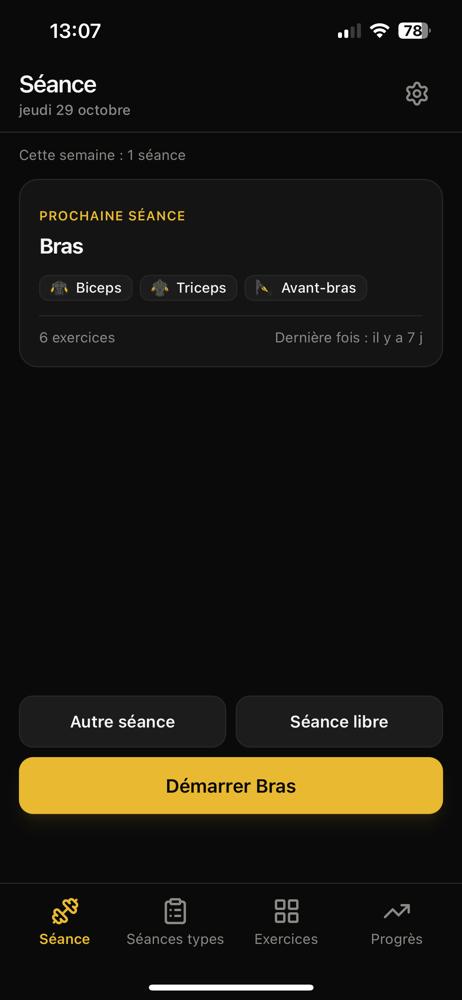
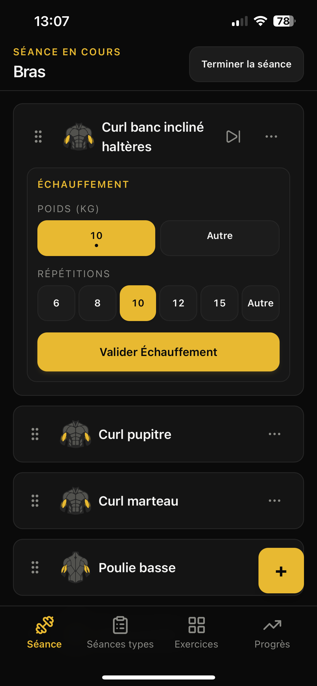
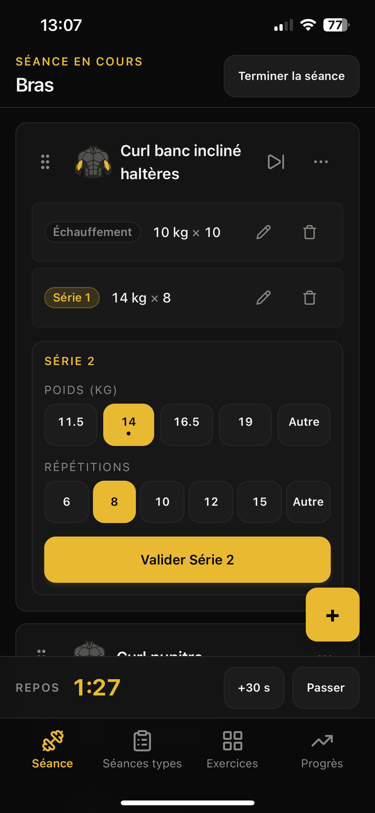
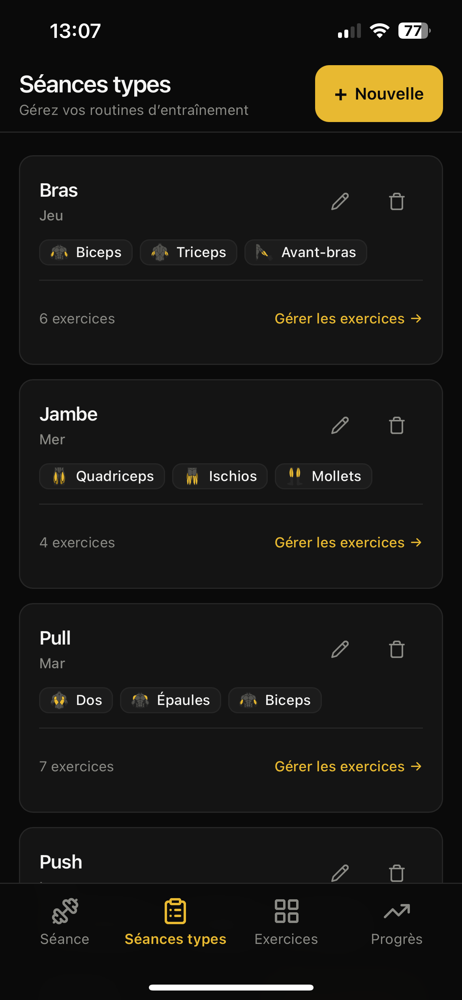
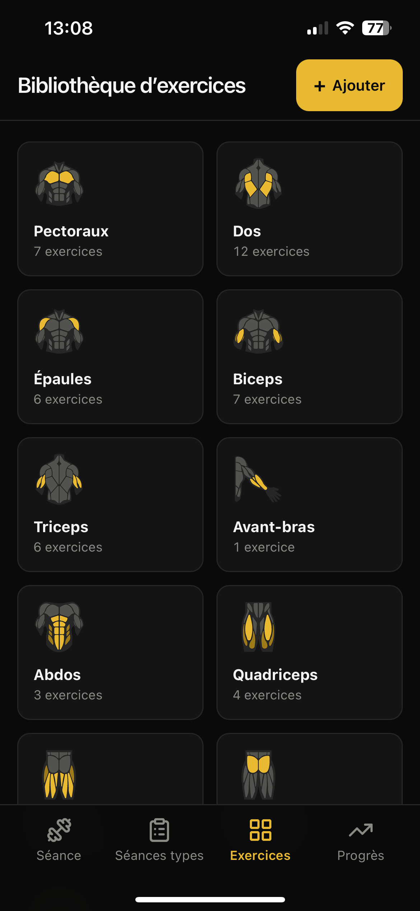
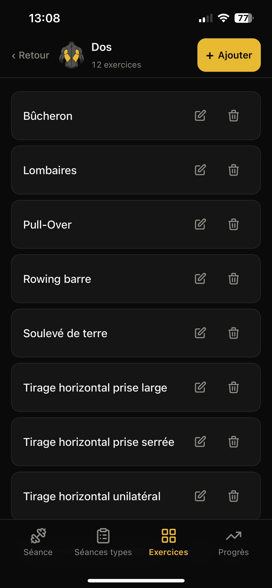
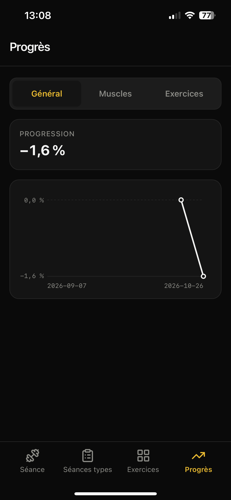
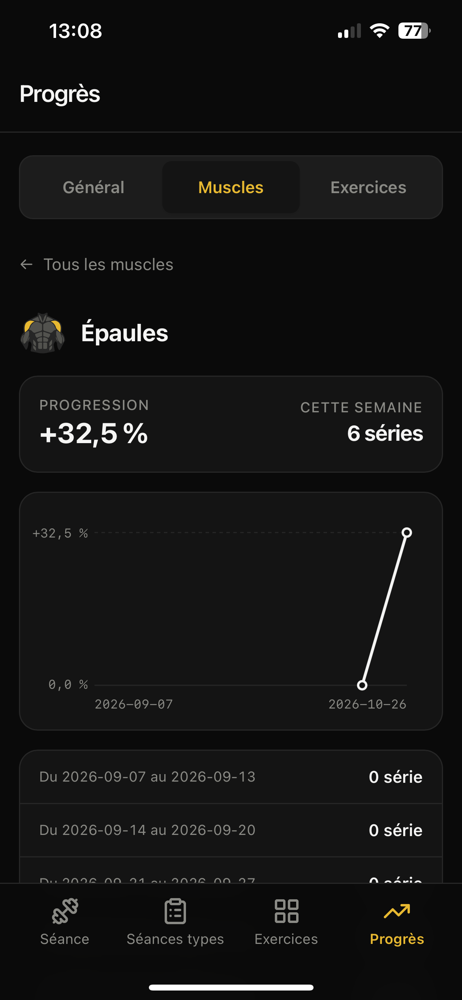
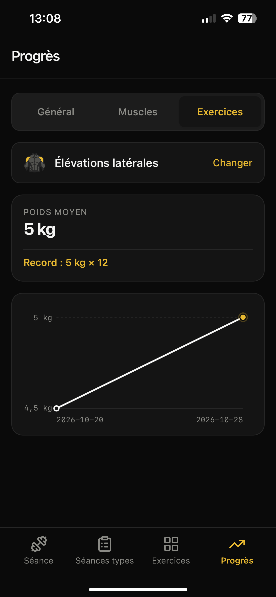
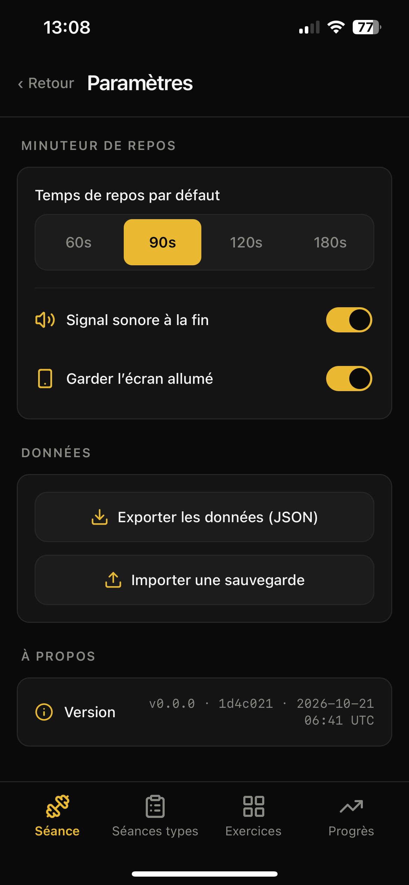

# 🏋️ Muscu PWA

Application de suivi de musculation, pensée pour l'iPhone et utilisable **hors-ligne**.
Elle s'installe sur l'écran d'accueil comme une app native. Toutes les données restent sur le téléphone.

> Projet personnel. Développé avec l'aide d'agents IA (Google Antigravity, Claude, Gemini).

**Application en ligne :** https://<ton-projet>.vercel.app

---

## 📸 Aperçu

| Accueil Séance | Séance en cours | Minuteur de repos |
|:---:|:---:|:---:|
|  |  |  |

| Séances types | Bibliothèque d'exercices | Choix d'un exercice |
|:---:|:---:|:---:|
|  |  |  |

| Progrès : Général | Progrès : Muscles | Progrès : Exercices |
|:---:|:---:|:---:|
|  |  |  |

| Paramètres |
|:---:|
|  |

---

## ✨ Fonctionnalités

### Séance
- Démarrage de la **prochaine séance** prévue, d'une autre séance type ou d'une **séance libre**.
- Résumé de chaque séance type : groupes musculaires (avec leurs icônes), nombre d'exercices et date de la dernière séance.
- Saisie rapide des séries **d'échauffement** et **de travail** : poids, puis boutons de répétitions 6 · 8 · 10 · 12 · 15 · Autre.
- Exercices **à passer, rétablir, retirer ou ajouter** pendant la séance, sans modifier la séance type.
- **Glisser-déposer** pour réordonner les exercices, avec une poignée adaptée au tactile.
- L'exercice ouvert apparaît en 2ᵉ position, sous l'exercice précédent.

### Minuteur de repos
- Il démarre automatiquement après chaque série validée.
- Boutons **+30 s** et **Passer**.
- Le temps est calculé à partir de l'heure de fin. Il reste donc juste même si l'app passe en arrière-plan ou si l'iPhone est verrouillé.
- Bip sonore en fin de repos (Web Audio) et écran maintenu allumé (Wake Lock).

### Séances types
- Création de programmes (par exemple Push, Pull, Jambes) associés à des jours de la semaine.
- Nombre de séries d'échauffement et de travail défini pour chaque exercice.

### Bibliothèque d'exercices
- Exercices par défaut créés dès le premier lancement.
- **11 groupes musculaires** : Pectoraux, Dos, Épaules, Biceps, Triceps, Avant-bras, Abdos, Quadriceps, Ischios, Fessiers, Mollets.
- Icônes anatomiques : le muscle travaillé est en or.
- Exercices personnalisés et archivage.

### Progrès
- **Général** : indice de progression en % sur 8 semaines.
- **Muscles** : progression et nombre de séries par semaine pour chaque groupe.
- **Exercices** : courbe du poids moyen et record personnel.

### Paramètres
- Durée de repos (60 s, 90 s, 2 min ou 3 min), son et écran allumé.
- **Export et import** des données en JSON, avec la feuille de partage d'iOS.
- Suppression de toutes les données, avec confirmation.
- Version, commit et date du build.

---

## 📊 Calcul des statistiques

| Notion | Définition |
|---|---|
| **Poids moyen par rep** | Σ(poids × reps) / Σ reps, sur les séries de travail des séances terminées |
| **Record** | Poids maximal, puis le plus de reps à égalité, puis la série la plus ancienne |
| **Indice de progression** | Pour chaque exercice : progression par rapport à sa première semaine de la période, puis moyenne simple |
| **Exercices au poids du corps** | Mode « reps » quand toutes les séries sont à 0 kg |

L'arrondi à 0,5 kg n'est appliqué qu'à l'affichage. Les semaines sont calculées en UTC.
Spécification complète : [`docs/specs/stats.md`](docs/specs/stats.md).

---

## 📱 Installation sur iPhone

1. Ouvrir l'application dans **Safari**.
2. Toucher **Partager**, puis **Sur l'écran d'accueil**.
3. Lancer l'app depuis l'icône. Elle fonctionne ensuite hors-ligne.

**Mises à jour :** après un déploiement, fermer complètement l'app puis la rouvrir. Le hash du commit affiché dans Paramètres change.

> ⚠️ Les données sont stockées **uniquement sur le téléphone** (IndexedDB).
> Supprimer l'app efface les données : faites un **export régulier** depuis Paramètres.

---

## 🛠️ Stack technique

| Domaine | Outil |
|---|---|
| Interface | React 19, TypeScript (strict) |
| Build | Vite, vite-plugin-pwa |
| Style | Tailwind CSS v4 (thème noir et or) |
| Données | Dexie (IndexedDB) |
| Icônes | lucide-react et icônes anatomiques recolorées |
| Glisser-déposer | @dnd-kit |
| Tests | Vitest, Testing Library, jsdom |
| Hébergement | Vercel (déploiement à chaque push sur `master`) |

---

## 💻 Développement

### Prérequis
- Node.js (version LTS)
- Git

### Installation
```bash
git clone https://github.com/PierreBvn/muscu-pwa.git
cd muscu-pwa
npm install
npm run dev
```

> Sous Windows (PowerShell), utiliser `npm.cmd` si `npm` est bloqué par la stratégie d'exécution.

### Scripts

| Commande | Rôle |
|---|---|
| `npm run dev` | Serveur de développement |
| `npm test` | Tests unitaires et de composants |
| `npm run verify` | Vérification complète : types, lint, tests et build |
| `npm run ship` | `verify`, puis `git push` seulement si tout passe |

---

## 📁 Structure

```
src/
├── db/            # Schéma Dexie, migrations, calculs (stats, résumés), sauvegarde
├── features/      # Écrans : séance, séances types, exercices, progrès, paramètres
├── components/    # Composants partagés (ConfirmDialog, Portal, MuscleIcon, ProgramSummary…)
├── assets/muscles # Icônes des 11 groupes musculaires
├── settings.ts    # Réglages (localStorage)
└── timer.ts       # Logique pure du minuteur
docs/
├── specs/         # Spécifications fonctionnelles
├── roadmap.md     # Avancement des lots
└── screenshots/   # Captures du README
scripts/           # Vérifications et traitement des images
.agents/skills/    # Règles spécialisées pour les agents IA
AGENTS.md          # Règles générales pour les agents IA
```

---

## 🧭 Principes d'architecture

- Aucun calcul dans les composants : la logique se trouve dans `src/db/` sous forme de **fonctions pures testées**.
- L'état de la séance est enregistré dans Dexie et lu avec `useLiveQuery`.
- Toute action destructive passe par `ConfirmDialog`.
- Interface pensée d'abord pour le mobile : zones tactiles d'au moins 44 px et gestion des zones de sécurité (safe areas) d'iOS.
- Tout changement de schéma passe par une **migration Dexie testée** : l'app contient des données réelles.

---

## 🤖 Développement assisté par IA

Ce projet sert aussi de terrain d'apprentissage pour développer avec des agents IA.

- **`AGENTS.md`** : règles générales lues par l'agent à chaque tâche, en moins de 100 lignes.
- **`.agents/skills/`** : règles par domaine (iOS/PWA, migrations, sauvegarde, stats, icônes, tests, paramètres), chargées seulement quand la tâche les concerne.
- **`docs/specs/`** : description du produit, à rédiger avant le code.
- **Méthode** : une conversation par tâche, le mode Planning pour les données et les nouveaux écrans, le mode Fast pour les petits changements d'interface, et `npm run ship` comme seule validation avant le push.

---

## 🗺️ Roadmap

Voir [`docs/roadmap.md`](docs/roadmap.md).

---

## 📄 Licence

Projet personnel, sans licence d'utilisation publique.
